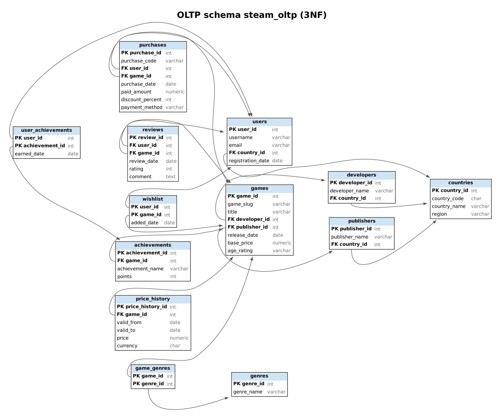
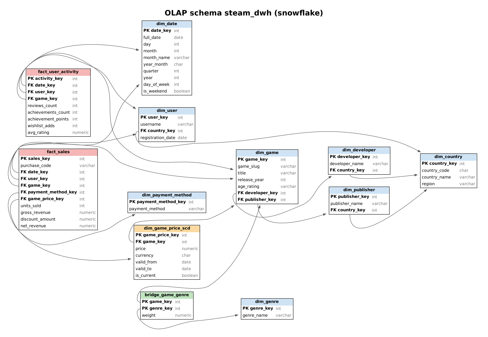
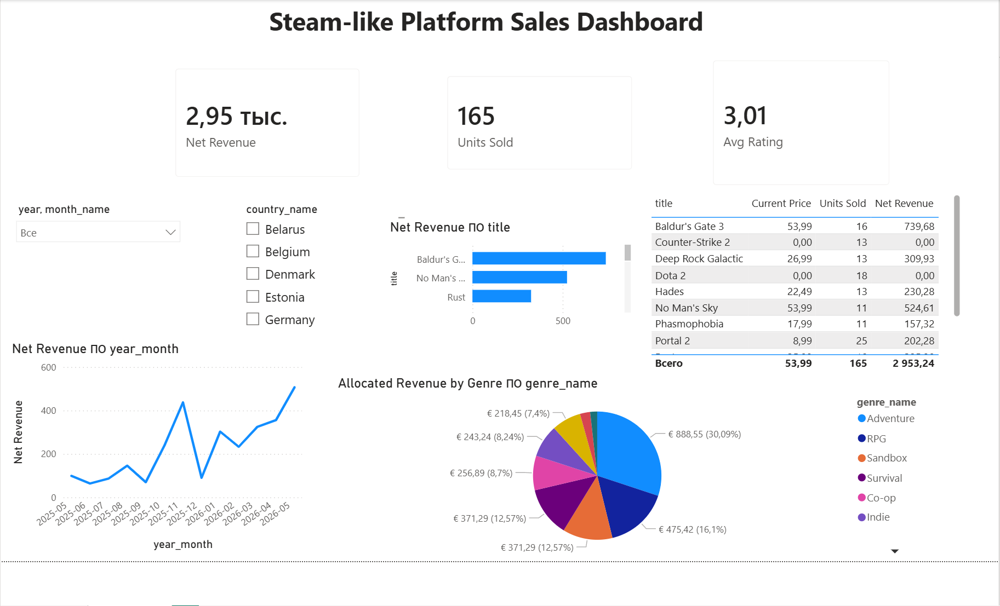

# 1. Scope

The topic is a Steam-like platform. Users buy digital games, add games to a wishlist, write reviews and earn achievements. Business analysts track sales and user activity. The DBMS is PostgreSQL 16. The OLTP and OLAP parts live in two separate databases: `steam_oltp_db` (schema `steam_oltp`) and `steam_dwh_db` (schema `steam_dwh`).

# 2. OLTP database context

The OLTP database stores accounts, countries, games, developers, publishers, genres, purchases, reviews, achievements, wishlists and the price history of every game. The schema has 13 tables in 3NF. Many-to-many links (games and genres, users and achievements) use junction tables. Every non-key attribute depends only on the key of its table.

{width=16cm}

| Table | Purpose | Key and constraints |
|---|---|---|
| countries | Country reference | PK country_id, UNIQUE country_code |
| users | Customer accounts | PK user_id, UNIQUE username and email, FK country_id |
| developers, publishers | Studios and publishers | PK id, UNIQUE name, FK country_id |
| games | Game catalog | PK game_id, UNIQUE game_slug, FK developer_id and publisher_id, CHECK base_price >= 0 |
| genres, game_genres | Genre dictionary and link | PK (game_id, genre_id) |
| purchases | Purchase transactions | UNIQUE purchase_code, UNIQUE (user_id, game_id), CHECK discount 0 to 100, payment method card or wallet |
| reviews | Ratings and comments | UNIQUE (user_id, game_id), CHECK rating 1 to 5 |
| achievements, user_achievements | Achievements per game and who earned them | UNIQUE (game_id, achievement_name), PK (user_id, achievement_id) |
| wishlist | Saved games | PK (user_id, game_id) |
| price_history | Price versions of a game | UNIQUE (game_id, valid_from), exclusion constraint against overlapping intervals, one open interval per game |

`games.base_price` is the launch list price. The price valid on a given day comes from `price_history`. A purchase stores `paid_amount = list price on purchase date * (1 - discount_percent / 100)`. The function `steam_oltp.change_price(slug, new_price, effective_date)` closes the open interval and opens a new one.

# 3. Data and loading

The data set has five CSV files, each with one table and no surrogate keys. Rows refer to each other by business identifiers: `username`, `game_slug`, `country_code`, `purchase_code`.

| File | Content |
|---|---|
| users.csv | 60 accounts with country and registration date |
| games.csv | 12 games with developer, publisher, their countries and genres separated by `\|` |
| price_history.csv | 42 price intervals, non-overlapping |
| purchases.csv | 165 purchases, one per user and game |
| user_activity.csv | 544 events: `wishlist`, `review` and `achievement` rows in one file |

`tools/generate_data.py` rebuilds the files with a fixed seed. It enforces these rules: one purchase and one review per user and game, no purchase before registration or release, reviews and achievements after the purchase, achievements only for owned games, and `paid_amount` computed from the price version valid on the purchase date. Countries are a fixed dictionary inside the load script.

`sql/02_load_csv_to_oltp.sql` loads each file into a temporary staging table and resolves business identifiers to foreign keys. Every upsert uses `ON CONFLICT ... DO UPDATE ... WHERE (old values) IS DISTINCT FROM (new values)`. A row whose values did not change is not touched, and the script can run any number of times. A closed price interval is history: the loader never reopens it. The whole load runs in one transaction. At the end it prints the number of CSV rows that could not be matched to a user, game or country (expected: 0).

# 4. OLAP database context

The warehouse answers these questions:

1. Which games and genres bring the highest revenue?
2. How do revenue, units and discounts change by month and year?
3. Which countries and regions buy the most?
4. How do current prices relate to historical sales, and what did each price version earn?
5. How do reviews, achievements and wishlist adds relate to engagement per game?

{width=16cm}

| Object | Role |
|---|---|
| fact_sales | Fact 1. One row per purchase: units, gross revenue (list price of the SCD version), discount, net revenue |
| fact_user_activity | Fact 2, aggregated. Reviews, achievements, points, wishlist adds and average rating per day, user and game |
| dim_game_price_scd | SCD Type 2: price, valid_from, valid_to, is_current |
| bridge_game_genre | Bridge between games and genres with weight 1 / number of genres |
| dim_date, dim_user, dim_game, dim_genre, dim_payment_method | Dimensions |
| dim_country, dim_developer, dim_publisher | Snowflaked: user, developer and publisher point to dim_country |
| etl_rejects | Records the ETL refused to load, with the reason |

The model differs from OLTP in three ways. Facts hold measures (gross revenue, discount, net revenue, points) that OLTP does not store. `fact_user_activity` merges three OLTP tables into one aggregated grain. Genres are reached through a weighted bridge, so allocated revenue adds up to the total.

# 5. ETL

`sql/04_etl_oltp_to_olap.sql` connects the DWH database to the OLTP database through `postgres_fdw` and runs these steps in one transaction:

1. **Reference data.** Countries, payment methods and a calendar from 2025-01-01 to 2026-12-31 define the permissible values.
2. **Dimensions.** Upserts with the same `IS DISTINCT FROM` guard as the loader.
3. **SCD Type 2.** A version that ended in OLTP gets `valid_to` and `is_current = FALSE`. A price version that does not exist yet becomes a new row. A different price for an existing version is refused and logged, because history is immutable.
4. **fact_sales.** Staging table `steam_stg.stg_sales`, then validation: date inside the calendar, known user, game and payment method, a price version valid on the purchase date, discount 0 to 100, no negative amount, no purchase before registration, `paid_amount` equal to list price and discount within one cent. Rejected rows go to `etl_rejects`, valid rows are published.
5. **fact_user_activity.** Reviews, achievements and wishlist rows enter `steam_stg.stg_activity`, pass validation (dates, keys, rating 1 to 5), then are aggregated and published.
6. **Control totals.** Row counts and net revenue are printed.

# 6. Run order

Run all scripts from the `sql` folder with `psql`. Replace the connection options with your own.

| Step | Command | Result |
|---|---|---|
| 1 | `psql -U postgres -f 00_create_databases.sql` | Creates both databases |
| 2 | `psql -U postgres -f 01_create_oltp.sql` | OLTP tables |
| 3 | `psql -U postgres -f 02_load_csv_to_oltp.sql` | Loads the CSV files (rerunnable) |
| 4 | `psql -U postgres -f 03_create_olap.sql` | DWH tables |
| 5 | `psql -U postgres -f 04_etl_oltp_to_olap.sql` | ETL (rerunnable) |
| 6 | `psql -U postgres -f 05_queries_oltp.sql` | 5 OLTP queries |
| 7 | `psql -U postgres -f 06_queries_olap.sql` | 6 OLAP queries |
| 8 | `psql -U postgres -f 07_demo_scd2.sql` | Price change demo for the defense |

If the OLTP database is on another host, pass `-v oltp_host=... -v oltp_port=... -v oltp_user=... -v oltp_password=...` to steps 5 and 8. `99_reset.sql` drops both databases.

# 7. Queries

Each OLTP and OLAP script answers questions over the same data, so results can be compared. OLTP query 4 and OLAP query 1 both compute revenue by genre. The totals match to the cent (2,953.24 net revenue in both databases). OLAP query 3 lists every price version of every game with the units and revenue sold at that price.

# 8. Power BI report

The report `powerbi/Steam_OLAP_Dashboard.pbix` connects to `steam_dwh_db` in Import mode and loads ten tables of schema `steam_dwh`: two facts, the bridge and seven dimensions. `etl_rejects` and the staging schema stay out of the model. Build steps and the DAX code are in `powerbi/POWERBI_GUIDE.md`.

{width=16cm}

**Transformations in Power Query**

- `fact_sales`: `gross_revenue`, `discount_amount` and `net_revenue` changed to fixed decimal number, `units_sold` to whole number.
- `dim_game`: `age_rating` changed to uppercase.
- `dim_date`: rows filtered to years 2025 and 2026, `full_date` typed as Date.
- `dim_game_price_scd`: `valid_from` and `valid_to` typed as Date.
- Tables renamed without the schema prefix, `month_name` sorted by `month`.

**Model**

Relationships run many-to-one from the facts to the dimensions, with single-direction filters. `dim_user` points to `dim_country`, so the country slicer filters both facts. The relationship from `dim_game_price_scd` to `dim_game` stays inactive, because an active one would open a second path from `dim_game` to `fact_sales`. The measure Current Price switches it on with `USERELATIONSHIP`.

**Measures**

- Net Revenue, Gross Revenue, Units Sold: sums over `fact_sales`.
- Discount Share: discount amount divided by gross revenue.
- Avg Rating: average review rating weighted by the number of reviews.
- Current Price: price of the SCD Type 2 version with `is_current = TRUE`.
- Allocated Revenue by Genre: net revenue of each game multiplied by its bridge weight, so genre values add up to total revenue.

**Page layout**

| Element | Fields | Question it answers |
|---|---|---|
| Title | Steam-like Platform Sales Dashboard | |
| Three cards | Net Revenue, Units Sold, Avg Rating | What are the totals for the selected period and country? |
| Slicer (dropdown) | `dim_date[year]`, `dim_date[month_name]` | Narrows every visual to a year or month |
| Slicer (list) | `dim_country[country_name]` | Narrows every visual to one or more countries |
| Line chart | `dim_date[year_month]`, Net Revenue | Which months earned the most? |
| Bar chart | `dim_game[title]`, Net Revenue | Which games bring the most revenue? |
| Pie chart | `dim_genre[genre_name]`, Allocated Revenue by Genre | Which genres bring the most revenue? |
| Table | `dim_game[title]`, Current Price, Units Sold, Net Revenue | How does the current price compare with past sales? |

**Findings with no slicer selected**

- Net revenue is EUR 2,953.24 from 165 purchases. Both numbers match the SQL control totals of the ETL.
- Sales run from May 2025 to May 2026. May 2026 is the best month with EUR 506.97, November 2025 the second with EUR 437.33.
- Baldur's Gate 3 earns the most (EUR 739.68). Portal 2 sells the most copies (25).
- Adventure leads the genres with EUR 888.55 (30.09%), RPG follows with EUR 475.42.
- Counter-Strike 2 and Dota 2 account for 31 purchases at EUR 0: free games added to a library.
- The average review rating is 3.01 out of 5.

# 9. Defense notes

- OLTP has 13 tables in 3NF. CSV files have no surrogate keys and number five.
- Load and ETL scripts do not modify rows whose values did not change. A test run of both scripts left every row version in both databases identical.
- OLAP is a separate database, a snowflake with two facts, one SCD Type 2 and one bridge. One fact is an aggregation of three OLTP tables.
- The SCD demo (`07_demo_scd2.sql`) changes the price of Hades in OLTP. The ETL closes the version valid until 2026-06-30 and adds a current version at 19.99.
- The ETL validates data and keeps refused records with a reason in `etl_rejects`.
